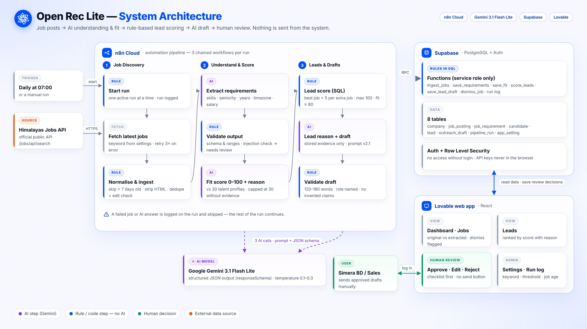

<p align="center"></p>

<h1 align="center">Open Recruitment</h1>
<p align="center"><b>AI-powered lead discovery for Simera's Business Development team</b><br>
AI reads and writes · Rules decide · People approve</p>

---

## Project Overview
Open Recruitment 
هو نظام داخلي لـ Simera، بيجهّز لفريق تطوير الأعمال والمبيعات (BD / Sales) كل يوم الصبح قائمة شركات بتوظّف أدوار بتقدر مواهب Simera تغطيها، ولكل شركة مسودة رسالة أولى جاهزة للمراجعة.

نوع الحل: **AI-Powered Workflow**. هو مش Agent ولا RAG: مراحل ثابتة، الذكاء الاصطناعي بيقرأ وبيكتب جواها، والقواعد هي اللي بتقرر.

## Problem & Target Users
- **المستخدمين:** فريق BD والمبيعات في Simera.
- **المشكلة:** الفريق بيدوّر يدويًا كل يوم على إعلانات وظائف، وبيقرأ كل إعلان، وبيقدّر الملاءمة، وبيكتب رسالة من الصفر. هاد بياخد ساعات، وبيوصّل الفريق متأخر أو بيضيّع فرص.

## Proposed Solution & Key Features
- **جلب تلقائي يومي** الساعة 07:00 من Himalayas API الرسمي: منع التكرار، وكشف التعديلات، وتجاهل الإعلانات الأقدم من 7 أيام.
- **فهم الإعلان بالـ AI** (Gemini): استخراج المتطلبات كـ JSON. أي معلومة مش مذكورة بتطلع `Not stated`، والنظام ما بيخمّن.
- **درجة ملاءمة 0–100 مع سبب**، مقابل 30 بروفايل مواهب. وفي قاعدة دليل: إعلان بدون متطلبات ما بياخد أكثر من 30.
- **ترتيب الشركات بقاعدة SQL ثابتة**: أفضل وظيفة مناسبة + 5 لكل وظيفة إضافية (حد أقصى 100)، والوظيفة مناسبة إذا درجتها 60 أو أكثر.
- **مسودة رسالة أولى بالـ AI** (130–170 كلمة)، وفيه فاحص بيرفض الوعود والروابط والادعاءات اللي ما إلها دليل.
- **مراجعة بشرية:** Needs review، واستبعاد مع سبب، وchecklist، واعتماد أو تعديل أو رفض. **ولا إشي بينبعت من النظام.**
- **حماية:** فحص Prompt injection، وقيود البلاد (وظائف محصورة ببلاد برّا مناطق مواهب Simera بتروح للمراجعة)، وتسجيل دخول، وRow Level Security.

## Technology Stack
| Layer | Tool | Role |
|---|---|---|
| Automation | **n8n Cloud** | 3 Workflows متسلسلة، وجدولة يومية، ومعالجة الأخطاء |
| AI | **Google Gemini 3.1 Flash Lite** | استخراج المتطلبات، ودرجة الملاءمة، والمسودات (JSON Schema) |
| Data | **Supabase** (PostgreSQL + Auth) | 8 جداول، ودوال SQL للقواعد، وRLS |
| Web App | **Lovable** (React) | Dashboard وJobs وLeads وReview وSettings |
| Source | **Himalayas Jobs API** | وظائف عن بُعد (عام، بدون مفتاح) |
| Testing | **Recus** · **PageSpeed Insights** | اختبار الواجهة، وجودة الموقع |

## How It Works


1. **Workflow 1 · Job Discovery:** بيبدأ تشغيل واحد بس بنفس الوقت، وبيجيب الوظائف، وبينظّفها، وبيحفظها.
2. **Workflow 2 · Understand & Score:** Gemini بيستخرج المتطلبات، والكود بيفحصها، وبعدين Gemini بيعطي درجة الملاءمة.
3. **Workflow 3 · Leads & Drafts:** SQL بيرتّب الشركات، وGemini بيكتب السبب والمسودة، والفاحص بيراجعها، وبعدين بتنحفظ للمراجعة.
4. **الواجهة:** الفريق بيراجع الوظائف والشركات والمسودات وبيقرر.

التفاصيل بـ [`docs/final-report.pdf`](docs/final-report.pdf).

## Setup / Access Instructions
**تجربة النظام:** الموقع محمي بتسجيل دخول. **بيانات حساب الديمو بتنعطى عند الطلب**، وما بتنحط بالريبو.

**تشغيل نسخة خاصة فيك:**
1. **Supabase:** شغّلي ملفات `src/supabase/` بالترتيب: `01` ← `02` ← `03` ← `04-11` ← `12`.
2. **n8n:** استوردي الثلاث ملفات من `src/n8n/`، وأضيفي Credentials:
   - `Supabase - Open Rec Lite` (Supabase API، بمفتاح service_role).
   - `Gemini - Open Rec Lite` (Google Gemini API).

   بعدين اربطي Run Step 2 و3 بالـ Workflows المستوردة، وانشري Workflow 1.
3. **Lovable:** ابني الواجهة بالبرومبتات اللي بـ `src/lovable/lovable_prompts.md`، واربطيها بنفس مشروع Supabase.

> المفاتيح (service_role وGemini API key) بتنحط بس جوا n8n Credentials، وعمرها ما بتنحط بالواجهة أو بالريبو.

## Demo Links
- **Live Demo:** https://simera-openrec.lovable.app (الدخول للفريق بس)
- **Video Demo:** _(الرابط بينضاف هون)_
- **Supporting Video (Section 5):** _(الرابط بينضاف هون)_

## Repository Structure
```
├── README.md
├── src/
│   ├── n8n/          # 3 workflow exports + js/ (Code nodes and prompts)
│   ├── supabase/     # SQL: schema, RLS, seed, pipeline functions, location rule
│   └── lovable/      # prompts used to build the web app
├── docs/             # client-proposal.pdf · system-architecture.png · final-report.pdf
├── content/          # brand-brief.md · main-content/ · supporting-content/ · prompts.md
├── tests/            # testing-evidence.md · dev-run-errors.md · known-issues.md
└── assets/           # simera-logo.png · screenshots/
```

## Known Limitations
- **مصدر واحد** (Himalayas) وكلمة بحث واحدة بكل تشغيل، و20 وظيفة بالتشغيل (حدود الخطة المجانية).
- **مواهب تجريبية:** 30 بروفايل mock، مش قاعدة مواهب Simera الحقيقية.
- **الـ AI ممكن يغلط** بالاستخراج أو الدرجة، عشان هيك في فحص بالكود ومراجعة بشرية، والمسودة ما بتنبعت تلقائيًا.
- **الإرسال يدوي:** ما في ربط مع إيميل أو CRM.
- **خطط مجانية:** حدود الطلبات بـ Gemini وn8n Cloud، وحدود إيميلات Supabase. الإنتاج بده Custom SMTP أو Google SSO.
- **التسجيل:** رابط Sign up لسا ظاهر بصفحة الدخول، وتسكيره مخطط له.

---
<sub>Built by **Eng. Lilian Abu Ramadan** — AI Automation Course, Final Capstone · Client: Simera Business Development</sub>
